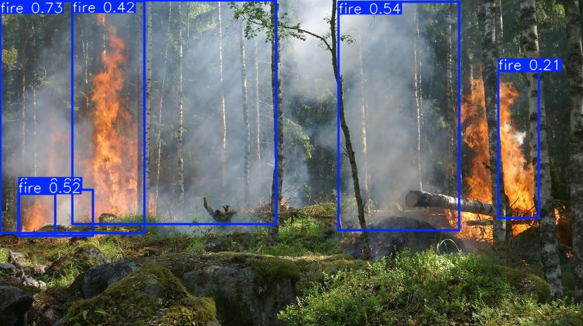
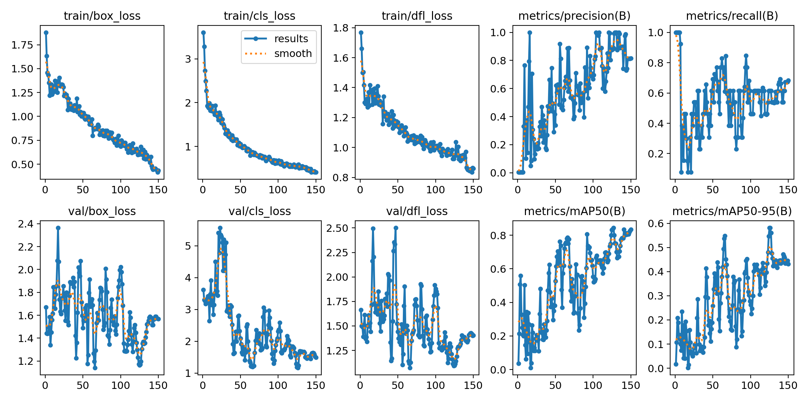
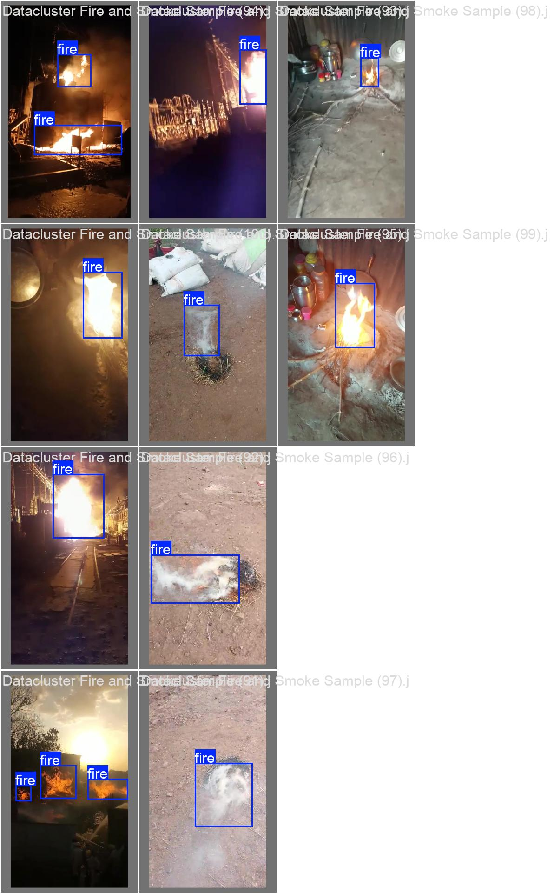
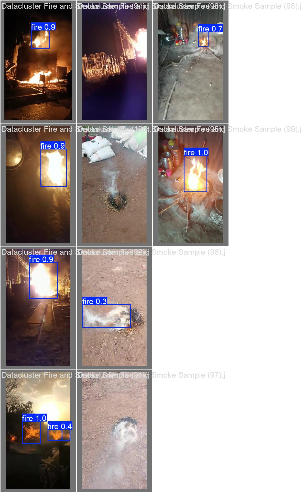
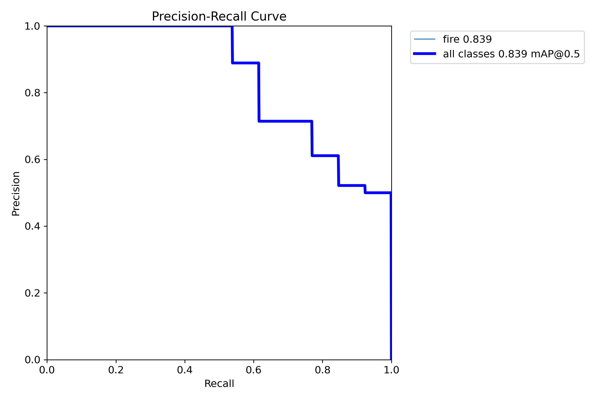

# Fire Detection with YOLO

An end-to-end object detection pipeline that finds **fire in images** using fine-tuned Ultralytics YOLO models. It covers labeling, annotation conversion, GPU training, evaluation, and inference on unseen images.


<sub>Inference on an image the model never saw during training (`forest_fire.jpg`, confidence ≥ 0.2).</sub>

| **Task** | Single-class object detection (`fire`) |
|---|---|
| **Models** | YOLOv8n and YOLO11n (Ultralytics), fine-tuned from COCO-pretrained weights |
| **Data** | 100 annotated images from the [DataCluster Labs Fire & Smoke dataset (Kaggle)](https://www.kaggle.com/datasets/dataclusterlabs/fire-and-smoke-dataset), split 80 / 10 / 10 |
| **Test result** | **mAP50 = 0.88**, mAP50-95 = 0.54, precision = 1.00, recall = 0.74 on the held-out test set (YOLOv8n) |
| **Stack** | Python, PyTorch, Ultralytics, OpenCV, Jupyter, CUDA (RTX 3050 Ti laptop GPU) |

## Pipeline

```
Kaggle images + Pascal VOC XML
        │  01_Convert XML to YOLO Format.ipynb
        ▼
YOLO labels  ──►  80 / 10 / 10 split  (datasets/Wildfire photos/)
        │  02_Model training.ipynb
        ▼
Fine-tuned YOLO weights  (runs/detect/*/weights/best.pt)
        │  03_Test.ipynb
        ▼
Detections on new images  (output_0.jpg)
```

`00_Image labeling.ipynb` is a small OpenCV tool for drawing boxes by hand and exporting them in YOLO format. It can be used to add images that aren't in the Kaggle set (example: `wildfire_aerial.jpg` → `wildfire_aerial.txt`).

## Results

Both models were trained on the same 80 training images at 640 px and evaluated on the same 10-image validation set (13 fire boxes). The checkpoint shown is the best epoch by Ultralytics' fitness score (0.1 × mAP50 + 0.9 × mAP50-95).

| Run | Model | Epochs | Batch | Best epoch | Precision | Recall | mAP50 | mAP50-95 |
|---|---|---|---|---|---|---|---|---|
| [`runs/detect/train`](runs/detect/train) | YOLOv8n | 150 | 16 | 126 | **0.88** | 0.62 | **0.84** | **0.58** |
| [`runs/detect/train2`](runs/detect/train2) | YOLO11n | 30 | 8 | 27 | 0.67 | **0.77** | 0.73 | 0.49 |

- **YOLOv8n trained for 150 epochs** gave the highest mAP and is the model used for inference (`03_Test.ipynb`).
- **YOLO11n reached 0.73 mAP50 in only 30 epochs** (≈ 1.5 minutes on a laptop GPU) and had higher recall. With a matched training budget it may close the gap, but this comparison is **not apples-to-apples**: the two runs used different epoch counts and batch sizes.

### Held-out test set

The selected YOLOv8n model was then scored once on the 10 test images (12 fire boxes), which were not used for training or model selection:

| Model | Precision | Recall | mAP50 | mAP50-95 |
|---|---|---|---|---|
| YOLOv8n (`runs/detect/train/weights/best.pt`) | **1.00** | 0.74 | **0.88** | 0.54 |

Test performance is in line with validation (mAP50 0.88 vs. 0.84). The model made **no false positives** on the test images, but it still missed about a quarter of the fire boxes, so recall remains the main weakness.

### Training curves (YOLOv8n)



Training losses fall steadily, but validation losses are noisy and plateau around 1.2–1.6, compared with about 0.4 for training. This is a clear sign of **overfitting** to a very small training set, which is expected with 80 images.

### Ground truth vs. predictions (validation set)

| Ground truth | Model predictions |
|---|---|
|  |  |

**Error analysis.** The model catches clear, well-lit flames with high confidence (0.9–1.0), and this batch has no false positives. It finds 8 of the 13 labeled fire regions. The misses fall into three patterns:

1. **Small or distant flames.** In the sunset scene, the smallest flame cluster is missed.
2. **Smoldering, smoke-dominant fires.** Two burning-debris patches with almost no visible flame are missed, and a third is detected with low confidence (0.3).
3. **Unusual lighting.** A night structure fire with a strong purple color cast is missed entirely, and in another night scene a second large fire region is missed.

These patterns point to the next steps below: more small-object and low-light examples, and a separate `smoke` class.



## Limitations

- **Very small evaluation sets.** With 10 validation images (13 boxes) and 10 test images (12 boxes), a single box changes recall by about 8 points, so all metrics above have wide uncertainty.
- **Domain gap.** The Kaggle images are mostly close-range, ground-level fires (debris, domestic, industrial). Aerial or long-range wildfire imagery would need additional data.
- **Fire only.** Smoke is not labeled as a separate class, although smoke is often the earliest visible sign of a wildfire.

## Next Steps

- [ ] Re-run YOLOv8n and YOLO11n with identical settings (epochs, batch, seed) for a fair comparison, ideally with k-fold cross-validation given the small dataset.
- [ ] Add more data, especially aerial and long-range wildfire imagery, small flames, night scenes, and hard negatives (sunsets, lights, orange foliage).
- [ ] Add a `smoke` class.

## Repository Structure

```
├── 00_Image labeling.ipynb               # OpenCV tool to draw boxes and save YOLO labels
├── 01_Convert XML to YOLO Format.ipynb   # Pascal VOC XML → YOLO txt
├── 02_Model training.ipynb               # GPU training (YOLO11n run shown)
├── 03_Test.ipynb                         # Inference on new images
├── datasets/Wildfire photos/
│   ├── images/{train,val,test}/          # 80 / 10 / 10 images
│   ├── labels/{train,val,test}/          # YOLO labels
│   └── wildfire.yaml                     # Dataset config
├── Wildfire photos/                      # Raw Kaggle images, XML annotations, converted labels
├── runs/detect/
│   ├── train/                            # YOLOv8n, 150 epochs (best model)
│   └── train2/                           # YOLO11n, 30 epochs
├── forest_fire.jpg / output_0.jpg        # Inference example (input / output)
├── wildfire_aerial.jpg / .txt            # Manual-labeling example
└── requirements.txt
```

## Quickstart

```bash
pip install -r requirements.txt        # for GPU, install the CUDA build of torch (see 02_Model training.ipynb)

# Inference with the trained model
yolo detect predict model=runs/detect/train/weights/best.pt source=forest_fire.jpg conf=0.2

# Evaluate on the test split (pass the dataset yaml as an absolute path)
yolo detect val model=runs/detect/train/weights/best.pt data="$(pwd)/datasets/Wildfire photos/wildfire.yaml" split=test

# Re-train (base weights download automatically)
yolo detect train model=yolov8n.pt data="$(pwd)/datasets/Wildfire photos/wildfire.yaml" epochs=150 imgsz=640
```

## Data & License

- Images and annotations come from the [DataCluster Labs Fire and Smoke Dataset](https://www.kaggle.com/datasets/dataclusterlabs/fire-and-smoke-dataset) on Kaggle and remain subject to that dataset's license.
- The code in this repository is released under the [MIT License](LICENSE).
